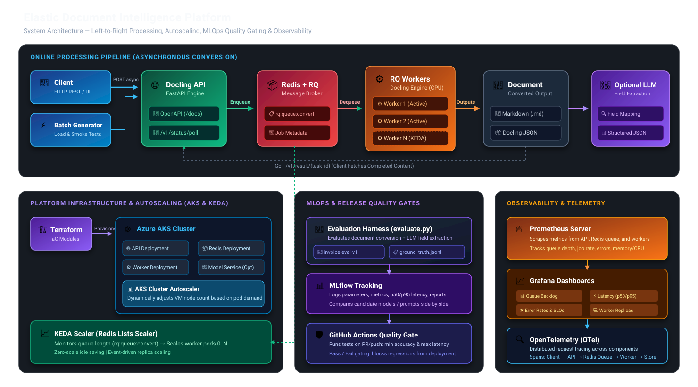

# Elastic Document Intelligence Platform

[](.github/workflows/ci.yml)
[](https://github.com/DS4SD/docling)
[](evaluation/evaluate.py)
[](LICENSE)

An enterprise-ready, asynchronous document conversion and intelligence platform demonstrating **asynchronous microservices**, **event-driven autoscaling**, **MLOps evaluation without retraining**, **reliability engineering**, and **cloud-native operations**.

---

## 🏛️ System Architecture



### High-Level Components:
- **Docling Serve API:** FastAPI service exposing `/health`, `/v1/convert/source/async`, and `/v1/status/poll/{task_id}`.
- **Message Broker:** Redis 7 with RQ queue (`rq:queue:convert`) for asynchronous workload decoupling.
- **Worker Pool:** `docling-serve rq-worker` processes that scale independently to drain document conversion tasks.
- **MLOps Quality Gate:** Python evaluation harness (`evaluation/evaluate.py`) validating extraction accuracy against ground truth datasets (`invoice-eval-v1`) and tracking experiments in **MLflow**.
- **Autoscaling (Phases 6–8):** Kubernetes Event-driven Autoscaling (**KEDA**) scaling worker pods dynamically based on queue depth, alongside the **AKS Cluster Autoscaler**.
- **Observability (Phase 7):** Prometheus scraping queue metrics and latency percentiles, visualized in Grafana dashboards with OpenTelemetry distributed tracing.

---

## 📂 Repository Structure

```text
docling-platform/
├── .github/
│   └── workflows/
│       └── ci.yml                     # Automated CI/CD pipeline & quality gate
├── docs/
│   ├── architecture.md               # Detailed system architecture specification
│   ├── architecture.svg              # Scalable vector architecture diagram
│   ├── architecture.jpg              # High-resolution raster diagram
│   ├── benchmark.md                  # Phase 3 worker scaling benchmark report
│   └── runbooks/
│       ├── release_rules.md          # SRE release gating & promotion rules
│       └── rollback.md               # Disaster recovery & rollback runbook
├── evaluation/
│   ├── dataset/
│   │   └── invoice-eval-v1/          # 25 synthetic invoices + ground_truth.jsonl
│   ├── prompts/                      # Extraction prompts (baseline vs. flawed)
│   ├── reports/                      # Evaluation output reports and error diffs
│   └── evaluate.py                   # MLOps evaluator & quality gate engine
├── infra/
│   └── terraform/                    # Cloud infrastructure (Azure AKS & network)
├── k8s/                              # Kubernetes manifests & KEDA ScaledObjects
├── monitoring/                       # Prometheus alerts & Grafana dashboard specs
├── reports/                          # Benchmark and failure test logs (Phases 1-3)
├── scripts/
│   ├── client.py                     # Reusable Docling API client abstraction
│   ├── smoke_test.py                 # One-command end-to-end smoke test
│   ├── submit_batch.py               # Concurrent load generator & benchmarking tool
│   └── test_worker_failure.ps1       # Fault tolerance & worker kill test
├── tests/
│   ├── unit/                         # Fast isolated unit tests (no server needed)
│   └── integration/                  # Live end-to-end API integration tests
├── docker-compose.yml                # Local Redis + API + Worker stack
├── pytest.ini                        # Pytest configuration & markers
├── pyproject.toml                    # Ruff linter & formatter configuration
└── requirements-dev.txt              # Pinned Python development dependencies
```

---

## 🚀 Quick Start (Local Docker Compose)

### 1. Start the Asynchronous Stack
```powershell
docker compose up -d
docker compose ps
```
The API is available at `http://127.0.0.1:5001` with interactive OpenAPI documentation at `http://127.0.0.1:5001/docs`.

### 2. Run the End-to-End Smoke Test
```powershell
# Set up Python virtual environment
py -m venv .venv
.\.venv\Scripts\Activate.ps1
pip install -r requirements-dev.txt

# Run automated smoke test
python scripts/smoke_test.py
```

### 3. Run Unit and Integration Tests
```powershell
# Run fast isolated unit tests
pytest tests/unit -v

# Run live integration tests (requires running containers)
pytest tests/integration -v
```

---

## 🧪 MLOps Evaluation & Quality Gating

The platform gates releases by comparing candidate extraction prompts/models against a ground-truth dataset (`invoice-eval-v1`):

```powershell
# Evaluate baseline candidate (passes with exit code 0)
python evaluation/evaluate.py --candidate baseline --min-field-acc 0.85 --min-schema-valid 0.95

# Evaluate deliberately flawed candidate (fails with exit code 1 to block release)
python evaluation/evaluate.py --candidate flawed --min-field-acc 0.85 --min-schema-valid 0.95
```

### Inspect Runs in the MLflow UI
```powershell
mlflow server --host 127.0.0.1 --port 5000
```
Open `http://127.0.0.1:5000` to inspect experiment metrics, accuracy comparisons, and error diffs.

---

## 📊 Milestone Progress

| Phase | Description | Status | Deliverables |
|---|---|---|---|
| **Phase 1** | Local conversion baseline | ✅ Completed | One-sample sync & async conversion, latency baseline |
| **Phase 2** | Redis + RQ Worker separation | ✅ Completed | Independent worker scaling, worker failure & fault recovery |
| **Phase 3** | Automated tests & load generator | ✅ Completed | `scripts/client.py`, `submit_batch.py`, 1-worker vs 2-workers benchmark |
| **Phase 4** | MLOps evaluation & MLflow | ✅ Completed | `invoice-eval-v1` dataset, `evaluate.py`, 97% accuracy, MLflow runs |
| **Phase 5** | CI/CD & Repository Hygiene | ✅ Completed | Ruff linting, test reorganization, `.github/workflows/ci.yml`, runbooks |
| **Phase 6** | Kubernetes & Terraform | ⏳ Next | Declarative Azure AKS cluster via Terraform |
| **Phase 7** | Observability & Telemetry | ⏳ Scheduled | Prometheus exporter, Grafana dashboards, OpenTelemetry |
| **Phase 8** | KEDA Autoscaling | ⏳ Scheduled | Event-driven scaling on `rq:queue:convert` with scale-to-zero |
| **Phase 9** | Optional Model Serving | ⏳ Optional | KServe / vLLM inference integration |
| **Phase 10** | Portfolio Packaging | ⏳ Final | Runbooks, tear-down guides, and project walkthrough |
