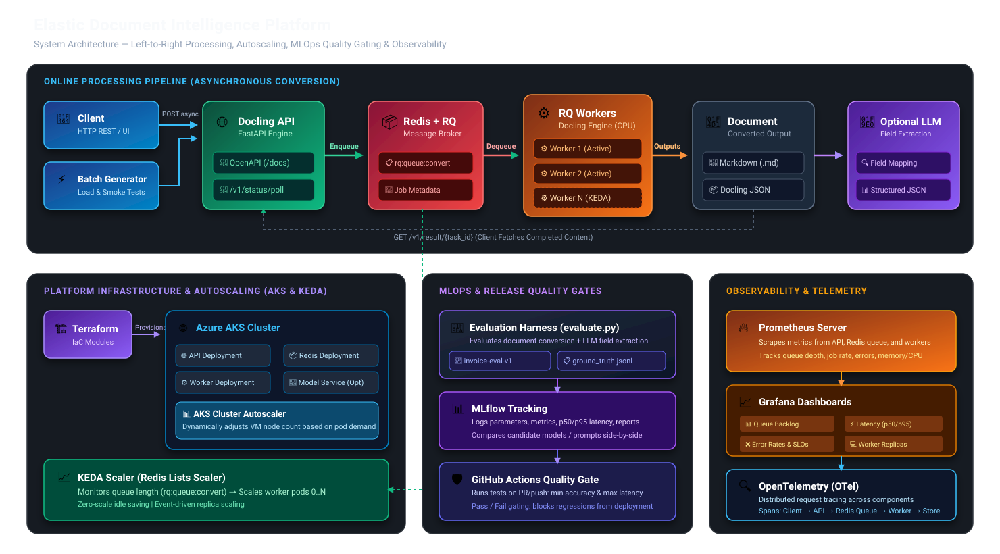

# System Architecture: Elastic Document Intelligence Platform



---

## 1. System Overview

The **Elastic Document Intelligence Platform** is an enterprise-ready, asynchronous document conversion and extraction system built with **Docling Serve**, **Redis RQ**, **Kubernetes (AKS)**, and an **MLOps evaluation and quality gating harness**.

### Key Architecture Decisions:
1. **Asynchronous Decoupling:** Ingestion API (`docling-api`) is strictly isolated from resource-intensive document conversion (`docling-worker`). Fast HTTP responses return a `task_id` within milliseconds while background workers process document hierarchies.
2. **Event-Driven Autoscaling (KEDA):** Worker scaling is driven by queue backlog length (`rq:queue:convert`) rather than lagging CPU metrics, scaling down to zero when idle.
3. **MLOps Evaluation Without Retraining:** Releases are gated by automated evaluation of schema compliance, field accuracy, and latency percentiles using MLflow tracking.

---

## 2. Core Workload Components

| Component | Technology | Role & Responsibility |
|---|---|---|
| **Ingestion API** | FastAPI / Docling Serve | Exposes OpenAPI (`/docs`), validates payloads, enqueues async jobs. |
| **Message Broker** | Redis 7 + RQ | Maintains conversion queues (`rq:queue:convert`) and job statuses. |
| **Conversion Workers** | Docling Serve RQ Worker | Consumes jobs, runs OCR & table layout parsing, outputs Markdown/JSON. |
| **Evaluation Harness** | Python + Pydantic + MLflow | Evaluates downstream field extraction against ground truth (`invoice-eval-v1`). |
| **Infrastructure** | Terraform | Provisions Azure Resource Groups, Virtual Networks, and AKS node pools. |
| **Autoscaling** | KEDA + Cluster Autoscaler | Scales worker pods based on queue length; scales VM nodes on pod demand. |
| **Observability** | Prometheus + Grafana + OTel | Scrapes queue depth, latency distributions (p50/p95), error rates, and traces. |

---

## 3. End-to-End Processing Paths

### Online Processing Path:
```text
Client / Load Generator
       │
       ▼
 Docling API (FastAPI)  ──[POST /v1/convert/source/async]──►  200 OK + task_id
       │
       ▼ Enqueue
 Redis (rq:queue:convert)
       │
       ▼ Dequeue
 Docling RQ Worker (1..N) ──► Converts Document (OCR, Tables, Hierarchy)
       │
       ▼ Store
 Converted Markdown / JSON
       │
       ▼ Optional
 Pretrained LLM ──► Structured Output (Normalized Schema)
```

### MLOps Evaluation & Quality Gating Path:
```text
 Synthetic Evaluation Dataset (invoice-eval-v1: 25 docs + ground_truth.jsonl)
       │
       ▼
 Evaluation Harness (evaluation/evaluate.py)
       │
       ├──► Logs Metrics, Parameters, and Artifacts to MLflow
       │
       ▼
 CI/CD Quality Gate (GitHub Actions)
       ├── Schema Validity >= 95%
       ├── Field Accuracy >= 85%
       └── Exact Match >= 75%
       │
   Pass: Exit Code 0 (Promote Candidate)
   Fail: Exit Code 1 (Block Release)
```
