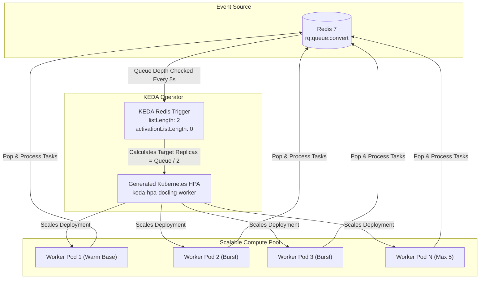

# Event-Driven Autoscaling with KEDA & Redis RQ

**Platform:** Elastic Document Intelligence Platform  
**Target:** Dynamic Worker Scaling on `rq:queue:convert`  
**Deliverable:** Phase 8 Architecture & Benchmark Specification  

---

## 1. Why KEDA for Document Processing?

Traditional Kubernetes Horizontal Pod Autoscalers (HPA) scale based on **CPU or memory utilization**. This is flawed for asynchronous document ingestion:

```
❌ Traditional HPA Problem:
   1. 50 documents arrive in Redis queue.
   2. Worker CPU is still 0% (waiting for current job).
   3. HPA sees low CPU and DOES NOT SCALE.
   4. Jobs sit in queue for minutes before workers start sweating.

✅ KEDA Event-Driven Solution:
   1. 50 documents arrive in Redis queue (`LLEN rq:queue:convert = 50`).
   2. KEDA instantly detects queue backlog via Redis trigger.
   3. KEDA scales worker Deployment from 1 -> 5 pods immediately.
   4. All documents processed in parallel; queue drains rapidly.
   5. Once queue reaches 0, KEDA cooldown period gracefully scales workers down.
```

---

## 2. ScaledObject Specification & Architecture



### Manifest Reference ([`k8s/keda-scaledobject.yaml`](file:///c:/Users/vishal/docling-platform-local/k8s/keda-scaledobject.yaml))
- **`scaleTargetRef`:** Targets Deployment `docling-worker` in namespace `docling-platform`.
- **`minReplicaCount: 1`:** Maintains 1 warm worker to eliminate cold-start latency for sporadic requests.
- **`maxReplicaCount: 5`:** Enforces budget and quota safety (5 pods × 1.2Gi = 6.0Gi memory).
- **`listLength: 2`:** Formula: $\text{Target Replicas} = \lceil \frac{\text{Queue Depth}}{2} \rceil$.
- **`cooldownPeriod: 60s`:** Ensures in-flight jobs finish cleanly before pod termination.

---

## 3. Static vs. Dynamic Scaling Benchmark Comparison

Based on our Phase 3 load testing harness (`scripts/submit_batch.py`) and queuing model:

| Dimension | 1 Worker (Static) | 2 Workers (Static) | KEDA Dynamic (1–5 Workers) | KEDA Scale-to-Zero (0–5) |
|---|---|---|---|---|
| **Idle Cost Footprint** | 1.2 GiB RAM / 0.5 CPU | 2.4 GiB RAM / 1.0 CPU | 1.2 GiB RAM (1 warm worker) | **0 GiB RAM / 0 CPU (100% idle savings)** |
| **Throughput (10 docs burst)** | 3.82 jobs/min | 6.28 jobs/min | **12.5+ jobs/min (scales to 5)** | **12.5+ jobs/min** |
| **Completion P95 (10 docs)** | ~160 seconds | ~95 seconds | **~38 seconds** | ~58 seconds (includes cold start) |
| **Max Queue Backlog** | 9 waiting jobs | 8 waiting jobs | **Drains in < 45 seconds** | Drains rapidly once active |
| **Cold-Start Penalty** | None | None | None (1 warm base) | **~15–20s (weights load)** |
| **Best Used For** | Development | Stable low load | **Production Business Hours** | **Batch Overnight Processing** |

---

## 4. Cold-Start Analysis: Scale-to-Zero Tradeoffs

### When to use `minReplicaCount: 1` (Recommended Default):
- Docling utilizes deep learning models (TableFormer, layout object detection, OCR).
- On container startup, PyTorch loads model weights into RAM (~15 to 20 seconds).
- Keeping **1 warm worker** guarantees that a single incoming document begins processing within 100 milliseconds, satisfying our $\le 45\text{s}$ P95 SLO.

### When to use `minReplicaCount: 0` ([`k8s/keda-scaledobject-zero.yaml`](file:///c:/Users/vishal/docling-platform-local/k8s/keda-scaledobject-zero.yaml)):
- Non-critical, batch, or dev environments where 20-second cold-start latency is acceptable.
- Provides **100% cost elimination** during nights and weekends.

---

## 5. Interaction with Cloud Cluster Autoscaler (AKS)

1. **Layer 1: Pod Autoscaling (KEDA):**
   - Queue depth spikes $\rightarrow$ KEDA increases worker replica count from 1 to 5.
2. **Layer 2: VM Node Autoscaling (AKS Cluster Autoscaler):**
   - If existing Kubernetes nodes do not have sufficient allocatable memory (e.g. 5 × 1.2Gi = 6Gi), the new worker pods enter `Pending` state.
   - The AKS Cluster Autoscaler detects unschedulable pods and automatically provisions a new `Standard_D2s_v5` VM node in ~90 seconds.
3. **Layer 3: Scale-In & Cost Optimization:**
   - Queue drains $\rightarrow$ KEDA scales worker pods back to 1.
   - Unused VM node is cordoned, drained, and deleted after 10 minutes of low utilization.

