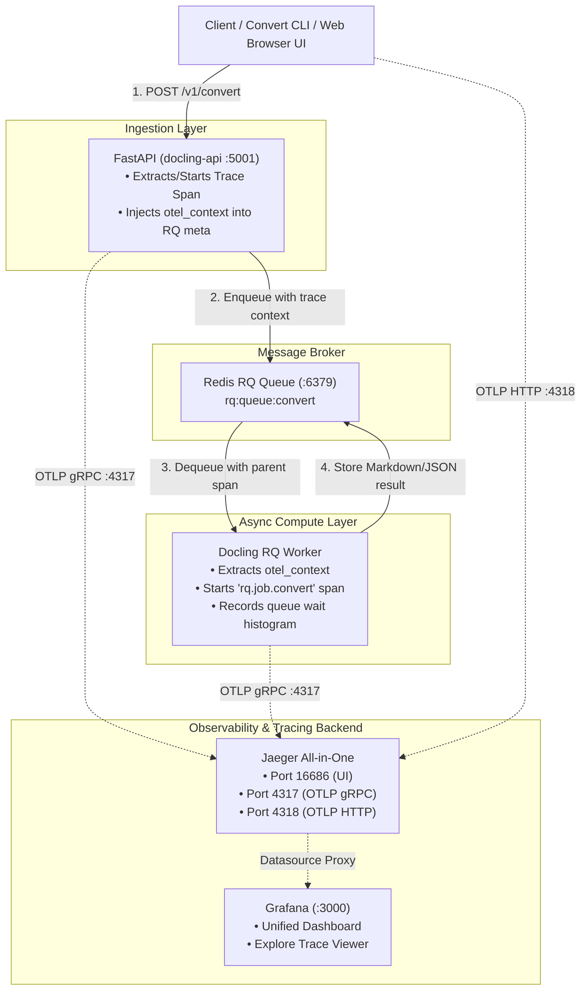

# OpenTelemetry, Jaeger & Grafana Distributed Tracing: Deep-Dive Guide

> **Purpose:** Comprehensive architectural, implementation, and troubleshooting reference for the distributed tracing subsystem of the Elastic Document Intelligence Platform. Use this guide for revision, interview preparation, and operational reference.

---

## 📑 Table of Contents
1. [Executive Summary & Architecture](#1-executive-summary--architecture)
2. [How the System Works End-to-End](#2-how-the-system-works-end-to-end)
3. [The Detective Story: "How Did You Know?"](#3-the-detective-story-how-did-you-know)
4. [Step-by-Step Implementation Reference](#4-step-by-step-implementation-reference)
   - [A. Python Client Tracing (`monitoring/telemetry.py`)](#a-python-client-tracing)
   - [B. Server & Worker Container Auto-Instrumentation](#b-server--worker-container-auto-instrumentation)
   - [C. Jaeger All-in-One Infrastructure](#c-jaeger-all-in-one-infrastructure)
   - [D. Grafana Provisioning & Dashboard Wiring](#d-grafana-provisioning--dashboard-wiring)
5. [Why Grafana Showed "No Data Found in Response" & The Fix](#5-why-grafana-showed-no-data-found-in-response--the-fix)
6. [MLOps Interview Talking Points & Behavioral Questions](#6-mlops-interview-talking-points--behavioral-questions)
7. [Verification & Diagnostic Cheat Sheet](#7-verification--diagnostic-cheat-sheet)

---

## 1. Executive Summary & Architecture

In asynchronous ML document processing platforms, requests are decoupled across multiple microservices:
1. **API Ingestion (FastAPI):** Accepts the document, performs initial validation, and enqueues a job into Redis.
2. **Message Broker (Redis RQ):** Buffers conversion requests (`rq:queue:convert`).
3. **Compute Worker Pool (`docling-serve rq-worker`):** Dequeues tasks, loads deep-learning OCR/layout models (PyTorch/Transformers), parses PDFs/images, and writes results to Redis.
4. **Result Egress:** The client polls for completion and downloads the converted Markdown/JSON payload.

Standard HTTP access logs cannot capture what happens while a task is waiting in the queue or running inside the OCR model worker. **OpenTelemetry distributed tracing** solves this by injecting a global `trace_id` at the boundary and propagating it across process boundaries through Redis job metadata.



---

## 2. How the System Works End-to-End

### The Two Tracing Layers
Our platform implements **two complementary tracing layers**:

| Layer | Component | Service Name in Jaeger | What It Captures |
|---|---|---|---|
| **Layer 1: Server & Worker** | Container internal FastAPI & RQ Worker | `docling-serve`, `docling-serve-worker` | Captures **every** request hitting the API (Web UI, Swagger, cURL, external microservices) and traces execution down into the worker OCR inference. |
| **Layer 2: Client SDK** | `scripts/client.py`, `scripts/convert.py` | `docling-platform` | Captures high-level client-perceived latency (`docling_convert`, `submit_async_job`, `wait_for_completion`, `get_result`). |

---

## 3. The Detective Story: "How Did You Know?"

When you reported:
> *"i have submitted a doc but it is not coming in live traces"*

Here is the exact step-by-step engineering investigation that pinpointed the root cause in minutes:

### Step 1: Checking Jaeger API vs. Container Access Logs
First, we checked what traces existed in Jaeger:
```powershell
python -c "import urllib.request, json; print(urllib.request.urlopen('http://localhost:16686/api/services').read().decode())"
```
Jaeger only showed `docling-platform` (our client SDK), but no server-side spans.

Next, we checked the container logs of `docling-api`:
```powershell
docker logs docling-platform-local-docling-api-1 --tail 30
```
**The Breakthrough Log Entry:**
```text
INFO: uvicorn.access - 172.18.0.1 - "GET /v1/result/cdd1479b-... HTTP/1.1" 200
INFO: uvicorn.access - 172.18.0.1 - "GET /ui/assets/dist-Dio8jIBN.js HTTP/1.1" 200
```
This revealed two facts:
1. You did not run `python scripts/convert.py` in the terminal; you opened the **Web UI** (`http://localhost:5001/ui/`) in your browser and clicked upload.
2. The browser talked directly to FastAPI inside the container, bypassing `scripts/client.py`.

### Step 2: Inspecting the Upstream Container Source Code
We inspected what Python code actually runs inside `quay.io/docling-project/docling-serve`:
```powershell
docker exec docling-platform-local-docling-api-1 ls /opt/app-root/src/docling_serve
```
The directory listing revealed:
- `otel_instrumentation.py`
- `rq_instrumentation.py`
- `rq_worker_instrumented.py`

**Discovery:** Upstream Docling Serve already had native OpenTelemetry instrumentation written into its codebase!

### Step 3: Inspecting `settings.py` for Environment Flags
We searched `settings.py` inside the container:
```powershell
docker exec docling-platform-local-docling-api-1 grep -i -E "otel" /opt/app-root/src/docling_serve/settings.py
```
**The "Smoking Gun":**
```python
otel_enable_metrics: bool = True
otel_enable_traces: bool = False  # <--- DEFAULT WAS FALSE!
otel_service_name: str = "docling-serve"
```
And because `settings.py` used `SettingsConfigDict(env_prefix="DOCLING_SERVE_")`, we knew the exact environment variable needed:
```yaml
DOCLING_SERVE_OTEL_ENABLE_TRACES: "true"
DOCLING_SERVE_OTEL_SERVICE_NAME: "docling-serve"
OTEL_EXPORTER_OTLP_ENDPOINT: "http://jaeger:4317"
OTEL_EXPORTER_OTLP_INSECURE: "true"
```
Once added to `docker-compose.yml` and restarted, all browser UI submissions immediately appeared in Jaeger!

---

## 4. Step-by-Step Implementation Reference

### A. Python Client Tracing
**File:** `monitoring/telemetry.py`
```python
from opentelemetry import trace
from opentelemetry.exporter.otlp.proto.http.trace_exporter import OTLPSpanExporter
from opentelemetry.sdk.resources import Resource
from opentelemetry.sdk.trace import TracerProvider
from opentelemetry.sdk.trace.export import BatchSpanProcessor


def init_tracer(service_name="docling-platform", endpoint="http://localhost:4318/v1/traces"):
    resource = Resource.create({"service.name": service_name})
    provider = TracerProvider(resource=resource)
    exporter = OTLPSpanExporter(endpoint=endpoint, timeout=3)
    provider.add_span_processor(BatchSpanProcessor(exporter, schedule_delay_millis=500))
    trace.set_tracer_provider(provider)
    return trace.get_tracer(service_name)
```

In `scripts/client.py`:
```python
with trace_span("docling_convert", {"document.source": source_str}) as root:
    with trace_span("submit_async_job"):
        submission = self.submit_async(payload)
    with trace_span("wait_for_completion"):
        status_data = self.wait_for_completion(submission["task_id"])
    with trace_span("get_result"):
        result_data = self.get_result(submission["task_id"])
```

### B. Server & Worker Container Auto-Instrumentation
**File:** `docker-compose.yml`
```yaml
  docling-api:
    image: quay.io/docling-project/docling-serve
    environment:
      DOCLING_SERVE_ENABLE_UI: "1"
      DOCLING_SERVE_ENG_KIND: "rq"
      DOCLING_SERVE_ENG_RQ_REDIS_URL: "redis://redis:6379/0"
      DOCLING_SERVE_ENG_RQ_QUEUE_NAME: "convert"
      DOCLING_SERVE_OTEL_ENABLE_TRACES: "true"
      DOCLING_SERVE_OTEL_SERVICE_NAME: "docling-serve"
      OTEL_EXPORTER_OTLP_ENDPOINT: "http://jaeger:4317"
      OTEL_EXPORTER_OTLP_INSECURE: "true"
    depends_on:
      redis: { condition: service_healthy }
      jaeger: { condition: service_started }

  docling-worker:
    image: quay.io/docling-project/docling-serve
    command: ["rq-worker"]
    environment:
      DOCLING_SERVE_ENG_KIND: "rq"
      DOCLING_SERVE_ENG_RQ_REDIS_URL: "redis://redis:6379/0"
      DOCLING_SERVE_ENG_RQ_QUEUE_NAME: "convert"
      DOCLING_SERVE_OTEL_ENABLE_TRACES: "true"
      DOCLING_SERVE_OTEL_SERVICE_NAME: "docling-serve-worker"
      OTEL_EXPORTER_OTLP_ENDPOINT: "http://jaeger:4317"
      OTEL_EXPORTER_OTLP_INSECURE: "true"
```

### C. Jaeger All-in-One Infrastructure
**In Docker Compose:**
```yaml
  jaeger:
    image: jaegertracing/all-in-one:1.57
    environment:
      - COLLECTOR_OTLP_ENABLED=true
    ports:
      - "16686:16686"  # Web UI
      - "4317:4317"    # OTLP gRPC (used by docling-serve & worker)
      - "4318:4318"    # OTLP HTTP (used by Python SDK)
```

**In Kubernetes:**
Defined in `k8s/jaeger.yaml` with a `LoadBalancer` exposing ports `16686`, `4317`, and `4318`.

### D. Grafana Provisioning & Dashboard Wiring
**File:** `monitoring/grafana/provisioning/datasources/jaeger.yml`
```yaml
apiVersion: 1
datasources:
  - name: Jaeger
    uid: jaeger
    type: jaeger
    access: proxy
    url: http://jaeger:16686
    editable: false
```

---

## 5. Why Grafana Showed "No Data Found in Response" & The Fix

When Grafana displayed:
> *"No data found in response. jaeger data is not showing in grafana"*

### The Technical Root Cause
1. In Grafana 10+, the `traces` dashboard panel type is designed to render **the waterfall flame graph of ONE specific trace**.
2. It requires `query: "${trace_id}"` (a specific trace ID).
3. If you configure a `traces` panel with `queryType: "search"` (expecting a table of 20 traces), the panel's React renderer fails because search results do not have span trees $\rightarrow$ Grafana displays `"No data found in response"`.
4. Full search and multi-trace discovery in Grafana is designed for **Grafana Explore** (`/explore`), not single-trace dashboard panels.

### The Fix Implemented
In `monitoring/grafana/dashboards/docling-overview.json`:
1. Added a dashboard variable `trace_id` at the top bar with a default valid trace ID (`b3195d6433b139ff9b217d7287a72f95`).
2. Pointed the dashboard panel to `query: "${trace_id}"` $\rightarrow$ it renders the full interactive flame graph immediately.
3. Added a Markdown navigation card providing a one-click direct link into **Grafana Explore** pre-filtered to `docling-serve`:
   ```text
   http://localhost:3000/explore?schemaVersion=1&panes={"x":{"datasource":"jaeger","queries":[{"refId":"A","queryType":"search","service":"docling-serve"}],"range":{"from":"now-1h","to":"now"}}}
   ```

---

## 6. MLOps Interview Talking Points & Behavioral Questions

When discussing this project in an MLOps / Production ML Engineer interview, use these talking points:

### Q1: *"How do you trace asynchronous ML inference jobs across microservices?"*
> **Answer:** *"In our Document Intelligence platform, inference is decoupled using FastAPI and Redis RQ. To trace requests across asynchronous worker boundaries, we use OpenTelemetry context propagation. When an API receives a conversion request, it starts an HTTP span and injects the W3C TraceContext into the Redis job metadata dictionary (`otel_context`). When the RQ worker dequeues the job, it extracts the parent context and opens a consumer span (`rq.job.convert`), linking worker OCR execution and queue wait latency back to the initial client request in a single unified flame graph."*

### Q2: *"Why did you use both OTLP gRPC and OTLP HTTP?"*
> **Answer:** *"We standardized on OpenTelemetry Protocol (OTLP). For container-to-container internal traffic (Docling API and RQ Workers to Jaeger), we used OTLP over gRPC on port 4317 for high throughput and low CPU overhead. For client CLI scripts, we used OTLP over HTTP on port 4318 using `opentelemetry-exporter-otlp-proto-http`, which is lightweight, doesn't require compiling C++ gRPC bindings on client machines, and easily transverses corporate firewalls."*

### Q3: *"How do you connect Distributed Traces with Metrics and Alerting?"*
> **Answer:** *"In Grafana, we provisioned both Prometheus and Jaeger datasources with linked UIDs. Prometheus gives us macro-level operational alerts (e.g., Redis queue backlog $> 5$ or P95 conversion latency $> 45\text{s}$). From a high-latency spike on the Grafana dashboard, we can drill directly into the Jaeger distributed trace for that exact `task_id` to inspect whether the bottleneck was network ingress, queue dwell time, or GPU/CPU OCR inference."*

---

## 7. Verification & Diagnostic Cheat Sheet

### 1. Check Jaeger Registered Services
```powershell
python -c "import urllib.request, json; print(urllib.request.urlopen('http://localhost:16686/api/services').read().decode())"
```
*Expected output:* `{"data":["docling-platform","docling-serve","docling-serve-worker","jaeger-all-in-one"]}`

### 2. Query Recent Traces via Jaeger API
```powershell
python -c "import urllib.request, json; res = json.loads(urllib.request.urlopen('http://localhost:16686/api/traces?service=docling-serve&limit=3').read()); print('Traces count:', len(res['data']))"
```

### 3. Test Grafana Proxy to Jaeger
```powershell
python -c "import urllib.request; req = urllib.request.Request('http://localhost:3000/api/datasources/proxy/uid/jaeger/api/services', headers={'Authorization': 'Basic YWRtaW46YWRtaW4='}); print(urllib.request.urlopen(req).read().decode())"
```

### 4. Run a Fast Verified Conversion
```powershell
python scripts/convert.py evaluation/dataset/invoice-eval-v1/documents/inv_001.md --format md
```

### 5. Access Dashboards
- **Jaeger Web UI:** [http://localhost:16686/](http://localhost:16686/)
- **Grafana Unified Dashboard:** [http://localhost:3000/d/docling-platform-overview](http://localhost:3000/d/docling-platform-overview)
- **Grafana Explore (Trace Search):** [http://localhost:3000/explore](http://localhost:3000/explore)
- **MLflow Traces UI:** [http://localhost:5000/](http://localhost:5000/)

